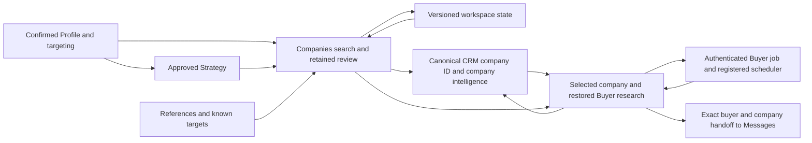

# Companies flow review — 17 November 2026

Scope: Companies, its Profile/Strategy inputs, and its direct Buyers/CRM/Messages handoffs. Changes are for review only. No deployment, schema migration, production database mutation, outreach, or real paid-provider execution was performed.

## Flow and authoritative owners



Companies is logical journey stage 4. Companies and Buyers share physical `step-5`; `meta.discovery.activeJourneyStage` and `setJourneyFocus` choose stages 4/5. Strategy is the previous physical page. Merely navigating/reopening does not authorize another research run.

| Boundary | Data and owner | Runtime path and checks |
| --- | --- | --- |
| Profile → Companies | Seller website, confirmed offers, ideal customer, exclusions, markets and Profile buyer committee | `companyQualificationProfile` in `customer/discovery-ui.js` combines confirmed targeting with the active ICP. Seller/reference domains are excluded. Profile/targeting confirmation and Strategy approval gate research. |
| Strategy → Companies | Active ICPs, signals/weights, selected markets, source context and signed Strategy authority | `fingerprint`, `sameStrategyFingerprint`, `syncStrategyFingerprint`, `LeadIntelStrategyIntegrity`, and `searchContextKey` bind results and asynchronous work to their original context. Actual material edits retain old evidence but mark it for review. |
| References/targets → Companies | Activated reference models, known target lists and optional event-company context | Explicit target/reference editors and imports supply domains and names. They are distinct from the seller identity. Selected markets and qualification settings are applied to these inputs too. |
| Companies research | Query plan, company mentions, official domains, readable sources, operating/market/exclusion checks and commercial fit | `startCompanyResearchFromStrategy`/`runCompanyDiscovery` run bounded work through the existing research ledger. Saved unfinished evidence is assessed before broadening. Search excerpts and model summaries alone do not become verified evidence. |
| Provider boundary | Search/read results and fit/extraction responses | Existing `/firecrawl-search`, optional `/api/ai/web-search`, `/api/ai/generate` company-extraction/buyer-fit tasks, and first-party website research. Cancellation, deadlines, authorization and run ownership protect late responses. The tests use controlled responses. |
| Workspace persistence | `discovery` candidates, review rows, selected prospects, pipeline, evidence, failures and usage; `meta.discovery` queue, run, goal and focus | `loadDiscovery` normalizes retained data and interrupted work; `saveDiscovery` marks local workspace data dirty. `server-bridge.js`/`workspace-persistence.js` synchronize versioned `/api/customer/state`. `backend/src/customer-state.js` and `workspace-record-store.js` persist SQL-backed records with conflict guards. |
| Results display | One canonical company identity across candidates, review rows and selections | `rankCompanyResults` deduplicates/ranks; ten rows are initially visible and the remainder are disclosed. Current scores, previous scores and unscored rows remain distinct. Checked results, strong fit (80+), automatic readiness and buying intent are separate states. Stable row keys/owners protect actions after sorting or refresh. |
| Companies editing | Goal, options, relevance feedback, target/reference inputs and qualification settings | The main company cards provide review, selection and saving; they do not offer an arbitrary company-name editor. Known targets use their dedicated editor/import. Validation rejects invalid goals/domains and applies actual exclusions; feedback is scoped to the current search context. |
| Review/refresh | Retained unfinished queue and original evidence | `companyReviewBatchPlan`/`reviewNextCompanyBatch` retain ordering/attempts under the current context, use bounded batches and preserve receipts. Failed providers, cancellation, pass limits and measured budget exhaustion remain separate outcomes. |
| Companies → CRM | Company identity and Company-owned intelligence | Save and qualified/known-target/review selection use the scoped mapper and `POST /api/crm/companies/company-research`. Membership/writer checks and domain/ID validation precede persistence. `crm_companies` deduplicates identity; `crm_intelligence` atomically patches Company-owned snapshot fields; earlier intelligence is retained in `crm_activities`. Buyer research/manual committee/contact records are preserved. |
| Companies → Buyers | `selectedProspects`, canonical domain, acknowledged `crmId`, evidence, qualification state, manual roles and active-company focus | Selection waits for CRM acknowledgement. Before new work, `restoreCompanyBeforeBuyerStart` awaits exact workspace/domain/ID-matched CRM detail, restores saved Buyer research, and holds the busy owner through restoration. Failed reads leave an explicit retry. Unselected public review of an unsaved potential company does not promote it to CRM. |
| Buyers job boundary | Company/role/source identity, durable job ID and checkpoints | Existing authenticated `/api/buyers/research` and registered `app.scheduled` work retain their role, authorization, revision and execution limits. A fresh qualified or saved-review selection was exercised through real HTTP/SQL, scheduler progress, browser close and fresh reopen. |
| Buyers → Messages/CRM | Exact company domain/CRM ID, person ID, confirmed source/recipient context, manual work and saved contact ID | Existing `addBuyerToFlow`, guarded contact/CRM saves, workspace acknowledgement and `leadintel:buyer-for-scripts` handoff bind the selected recipient. Companies refresh/reopen must preserve saved buyers and message drafts. Message approval and sending retain their own controls. |

Clearing search results has a deliberate existing contract: the in-app confirmation clears search work and unsaved Buyer selections, while retaining saved CRM/pipeline/settings. Cancel/Escape, context changes and active work are guarded. This contract was retained.

## Confirmed defects and focused fixes

1. **Unchanged Strategy could invalidate every company.** In a controlled reproduction using the actual Market revalidation code, evidence aging changed an opportunity priority from 65 to 61 between 14 and 17 November while the authoritative Strategy digest and approval remained unchanged. The Companies fingerprint redundantly compared that derived score. Signed, matching Strategy digests now permit that derived-score difference only; actual profile/market/signal/settings changes and malformed/legacy authority remain strict. A persisted global hold is recovered only after workspace reconciliation when the original run and every retained checked company match the current approved scope. Explicit company/version rechecks remain.

2. **A genuinely stale company could disappear from the pending review queue.** Its operating/commercial fit still passed, so the queue counted it as checked even though its Strategy scope was previous. The checked set now requires `companyStrategyCurrent`. The actual qualification/UI regression changed from zero pending rows to the expected one without starting provider work.

3. **Companies Save could erase current CRM Buyer research.** A real Save click and authenticated HTTP/SQL reproduction changed the current saved Buyer roster from two people to zero, lost the research timestamp/incomplete state, and left only an archived copy. The new company-only endpoint and shared whitelist exclude Buyer-owned fields/contacts. SQLite `json_patch` merges against the row at the transaction boundary, preserving a newer concurrent Buyer write as well as existing manual committee data. Normal deliberate Buyer-owner snapshot replacement remains available. The dedicated path also makes an older backend reject the new request before it can perform an unsafe full snapshot replacement.

4. **Selection raced CRM-only restoration and lost manual committee ownership.** With delayed CRM reads, selection could start new research with an empty roster/Profile roles before saved buyers arrived. Even normal hydration could replace the saved manual role source after reopening. Selection/retry now await a scoped CRM read before deciding whether new work is needed, reuse retained research, keep duplicate-click/context guards, and expose `Retry loading saved buyers` after read failure. Empty/generated local compatibility fields no longer override a saved manual committee; explicit local manual edits remain authoritative. Both delayed-read and failed-read/retry browser reproductions retain both buyers and the manual committee after SQL save/fresh reopen with zero new jobs/provider calls.

5. **Selected targets lost their CRM ID during normalization.** `safePotentialCandidate` omitted `crmId`, affecting target and without-signal selections on reload. It now retains the cleaned authoritative ID. Regression cases verify both modes through two serialization/normalization cycles. Existing scoped CRM validation still rejects mismatched IDs, domains or workspaces.

## Verification

The local harness serves the actual customer app in Chromium, authenticates through the app's HTTP routes, and uses ephemeral SQLite with the project's WASM loader. External browser requests are blocked. Scheduler tests enter through the registered application wrapper; controlled provider fixtures do not establish real-world research yield.

Completed checks at the time of writing:

- 161 upstream/control/import/navigation/recovery tests passed during the expanded investigation.
- Final backend CRM/Companies/Buyer-store/routes/runner/scheduler set: **144 passed, zero failed or skipped**.
- Focused selection, CRM restore, persistence and Companies lifecycle set: **202 passed, zero failed or skipped**. Connected Strategy lifecycle and handoff gates: **27 passed**.
- Authenticated HTTP/SQLite/Chromium journeys: **11 passed, zero failed or skipped**. This includes both fresh Buyer starts through the registered scheduler and all nine Companies save/review/reopen cases.
- Local static build: `npm run build` passed, including the bounded Discovery/bootstrap validation.
- Independent reviewer found no remaining Important/Critical issue in the reviewed save/restore boundaries. It independently exercised delayed CRM restoration and fresh Chromium reopen, and separately verified unsaved potential review performs zero CRM reads/writes.

The recovered complete customer-suite log and exit receipt confirm **6,342 passed, zero failed, 11 skipped**, exit 0 (6,353 total). Its 11 browser cases passed separately under the WASM loader as recorded above. This run preceded the subsequent Market Research incident changes; it is evidence for the Companies review revision. Historical CI for an earlier branch revision is not acceptance evidence for these local changes.

The expanded run also exposed fixtures that omitted the newly required scoped CRM read and a source-string assertion tied to the old function layout. These were updated without dropping the original behavior assertions; the stale-CRM admission gate is now tested by executing the runtime. A 30ms Strategy deadline fixture was made deterministic by entering both held provider calls before firing the actual run deadline callback. The optional contact-review timeout fixture now gives successful core research sufficient time before testing its held optional review; shipping time limits were unchanged.

Relevant commands:

```sh
node --test --test-concurrency=4 customer/test/*.test.js
node --test customer/test/buyer-selection-start.test.js customer/test/company-crm-start-restore.test.js customer/test/crm-integration.test.js customer/test/company-recovery-capacity.test.js customer/test/discovery-global-timeout.test.js
node --import ./backend/test/register-wasm-loader.mjs --test --test-concurrency=2 backend/test/crm*.test.mjs backend/test/companies*.test.mjs backend/test/buyer-research-jobs-store.test.mjs backend/test/buyer-research-jobs-route.test.mjs backend/test/buyer-research-jobs-runner.test.mjs backend/test/buyer-research-scheduler.test.mjs
node --import ./backend/test/register-wasm-loader.mjs --test --test-concurrency=1 customer/test/company-search-persistence.test.js customer/test/buyer-start-persistence.test.js
npm run build
git diff --check
```

Coverage includes empty/unresearched records, invalid input/identity/scope, domain duplicates, partial/failed/cancelled research, delayed/failed CRM loads and retry, concurrent commits, rapid selections, reordered rows, Strategy/account/workspace changes, clear cancellation, retained evidence, queue budget/order, navigation, SQL save and fresh browser reopening. Backend tests also verify immutable previous snapshots and normal Buyer-owner saves.

## Limits of the evidence

- The user's signed-in browser/private workspace was unavailable: the supplied Companion Page snapshot was empty and this session exposed no connected browser-control tool. The managed proxy also denied the production hostname. The exact 31 private records in the screenshot were therefore not inspected or repaired in production.
- The false-reset reproduction confirms a code defect consistent with an unchanged Strategy; it does not establish that every private row in the screenshot has that cause.
- Provider responses were controlled fixtures. Actual Firecrawl/AI yield, real contact availability and paid-provider outcomes were not verified or purchased.
- Production D1 behavior and release compatibility have not been claimed from local SQLite tests. No deployment or schema migration was performed; changes remain for review under the user's no-deploy instruction.
